# Test, then Route: How Language Models Execute In-Context Conditional Rules Across Models and Languages

Luxshan Thavarasa 1 , Sivasuthan Sukumar 2

1 Independent Researcher, Colombo, Sri Lanka

2 Department of Computer Science and Engineering, University of Moratuwa, Sri Lanka

luxshanlux2000@gmail.com, sivasuthan.26@cse.mrt.ac.lk

## Abstract

When a language model follows an in-context conditional rule such as "if P (x) then A else B," does it assemble a runtime circuit with one module that tests the predicate and another that routes the answer? We probe this with activation patching under a four-donor design whose two swapped-rule donors make the condition and the answer word disagree, so each layer reveals which of the two it carries. Across three open models from two families and six languages sharing one fixed item bank, a mid-stack residual band carries the predicate's truth value: patching it reroutes the answer with predicate-outcome flip near 1.0 and mapping flip near 0.0, meeting a strict prespecified isolation criterion in 17 of 18 cells, and the same localization holds across five predicate families. The router shows the opposite profile. A learned subspace flips A↔B near-perfectly within the trained pair yet transfers to a new pair at ≈0 in every model, while in Gemma-3-4B (the only model probed cross-lingually) it transfers at ≈0.98 to the same pair in other languages. Under every probe we ran, the router direction is token-bound and non-transferable (largely answer-readout in Gemma, pair-specific in Qwen) rather than an abstract routing module. Test is modular; under these probes, route is not.

## 1 Introduction

A large language model given an in-context conditional rule ("if P (x) then A else B") must do two things to answer a query: test whether the predicate P (x) holds, and route the appropriate answer, A or B, to the output. Whether the model assembles these as separable parts, or entangles testing and routing in one indivisible mechanism, is a basic question about how in-context rules are executed, and one that behavioral evaluation cannot answer: a correct completion is consistent with either organization.

Most mechanistic circuits characterized to date are weight-stored: pretrained, reusable mechanisms invoked for a fixed task, such as the Indirect Object Identification circuit (Wang et al., 2023) or induction heads (Olsson et al., 2022). The conditional rule is different: its text, predicate, and answer mapping are all supplied at inference time and vary from prompt to prompt, so any circuit executing it must be assembled at runtime. This places our object of study alongside function and task vectors (Todd et al., 2024; Hendel et al., 2023) and filter heads (Sharma et al., 2026), but shifts the question from what in-context content is represented to how a two-part conditional computation is factored across the residual stream. Deployed prompts are dense with such conditionals (guardrails, tool-routing, conditional policies; Appendix B), and which half is modular determines what can be audited and steered portably.

We study a canonical rule ("if the number is greater than 5, output dog, otherwise cat"), presented with eight demonstrations and a numeric query whose single-token answer the model completes. Our central move is a set of four donor prompts (Figure 2) that, through activation patching, read off per layer whether a residual-stream site carries the predicate's truth condition or the routed answer word. The two critical donors make the condition and the answer disagree: the MAP-DONOR swaps the rule's answer mapping while holding the predicate true; the MAP-NULL does so while holding it false. A layer that follows the truth value holds the condition; one that follows the answer word holds the readout. This exposes a sharp stage boundary (Figure 3): a mid-stack TEST stage where patches follow the condition, and a later ROUTE stage where they follow the answer.

Applying this, we find a clear asymmetry. The predicate-TEST is a causally separable, localizable module: patching a single mid-stack band flips the answer by flipping only the predicate's truth

value. Under every probe we ran, the argumentROUTE shows no separable, transferable subspace: the direction that appears to route the answer flips one label pair but does not transfer to another. Test is modular; route, under these probes, is not.

Our contributions are the condition-vs-answer disagreement design itself (Figures 2, 3), run as a shared-bank multilingual protocol: one fixed item bank rendered fully in each of six languages, with only the numerals and answer tokens held fixed. Applying it yields a separable predicate-TEST band, localized over two label pairs, a three-output variant, and multi-token answers, and reproducing across three models from two families, six languages, and five predicates; and a non-separable ROUTE: a learned subspace (distributed alignment search, DAS) with a transfer control flips the trained label pair in every model yet does not transfer to a new pair (in Gemma-3-4B it does transfer across languages), a token-bound readout direction rather than a reusable router; without the transfer control, the within-pair interchange accuracy of 1.00 would have certified a spurious router in all three models. An exploratory contrast with the weight-stored IOI circuit appears in Appendix C. Code, data, and per-cell results will be released. 1

## 2 Related Work

Circuits and activation patching. Mechanisticinterpretability work localizes behavior to sparse subgraphs of attention heads and MLPs by causal intervention: indirect-object identification set the template for reading off a task-specific circuit (Wang et al., 2023), activation- and path-based patching supply the causal-mediation machinery (Meng et al., 2022; Goldowsky-Dill et al., 2023; Vig et al., 2020), and circuits can be reused across tasks (Merullo et al., 2024). These circuits are predominantly weight-stored: pretrained structures that a prompt merely activates. Stage structure in in-context tasks is also emerging: a universal mid-stack request→execution split (Variengien and Winsor, 2025) and modular sub-circuits for in-context propositional inference (Hong et al., 2025; Kim et al., 2025; Chen et al., 2026). We decompose an in-context conditional (predicate evaluation vs. answer routing with an explicit else branch) under donors that make condition and answer disagree.

In-context learning as vectors, subspaces, and functions. A complementary tradition compresses in-context tasks into portable representations: function and task vectors summarize a demonstrated mapping into a single transplantable activation (Todd et al., 2024; Hendel et al., 2023), with follow-ups on their generalization, filter-like selection heads, concept subspaces, and algorithmic primitives (Ye et al., 2025; Sharma et al., 2026; Tang et al., 2026; Lippl et al., 2026). This literature asks what mapping is applied; we ask how a conditional rule is decomposed into a predicate TEST and an argument ROUTE, and find that under our probes the ROUTE admits no separable, transferable subspace. Transportable filter-head predicates (Sharma et al., 2026) independently support TEST-separability; that setting has no else-branch or routing analysis, where the asymmetry lies.

Variable binding and routing. How models bind entities to roles and route values to slots is central to symbolic-style computation in transformers (Feng and Steinhardt, 2024; Wu et al., 2025), with desiderata for probing binding causally (Davies et al., 2023) and evidence that models mix distinct mechanisms for a single behavior (Gur-Arieh et al., 2026). Our task is a routing problem in this sense, but the disagreement donors expose, per layer, whether a band holds the condition or the answer word: a TEST/ROUTE stage boundary rather than a single binding operation.

Steering, decodability, and multilingual mechanisms. Directional interventions can steer behavior, even conditionally (Lee et al., 2025; Arditi et al., 2024), yet a decodable or steerable direction need not be a causally separable, invariant mechanism (Nadaf, 2026; Opiełka et al., 2026), and interchange success alone is weak evidence: optimization-found subspaces can pass it while illusory, even on randomly initialized models (Makelov et al., 2024; Sutter et al., 2025), and concurrent work stress-tests head-level claims by transfer (Quirke, 2026). Separately, multilingual analyses find computation routed through a shared, largely English-centric internal space (Wendler et al., 2024; Zhao et al., 2024), with cross-lingual patching separating concept from language (Dumas et al., 2025) and near-identical circuits across two languages (Ferrando and Costa-jussà, 2024). Our transfer control distinguishes a genuine routing subspace from answer-readout: a learned ROUTE direction that flips one label pair but fails to trans-

[^1]: https://github.com/Luxshan2000/ icl-conditional-circuits

fer to another is entangled with readout, not separable. Our TEST band recurs at mid-stack across six languages and four scripts (including Tamil and Sinhala, to our knowledge new to mechanistic localization), and in Gemma-3-4B the readout direction for a fixed pair is language-invariant (§4.2).

## 3 Methodology

## 3.1 Task and Dataset

We study in-context conditional rules of the form "if P (x) then A else B." The canonical English rule is "Rule: if the number is greater than 5, output dog, otherwise output cat." Each prompt concatenates the rule, eight in-context Number/Output demonstrations, and a query number; the model completes a single answer token. The predicate is P (x) ≡ (x > 5), and the answer labels A = dog, B = cat are single tokens.

All experiments draw from one fixed canonical bank of 250 items, shared by every experimental cell (every model and every language), so no cross-cell comparison is confounded by a different random sample. The six languages (en, zh, hi, id, ta, si) are rendered from this bank in full (rule and demonstration scaffold alike), while the numerals and the answer labels dog/cat stay in Latin script and single-token form, so cross-lingual tokenization variation falls on the prompt text but never on the measured answer (Appendix A details the translation protocol): the manipulation targets rule and scaffold comprehension while holding the readout interface constant. The languages span four scripts and a wide resource range (Tamil and Sinhala are new to mechanistic localization). Each cell is also rendered under a second single-token pair (fox/owl); grid curves pool both pairs. Alternative predicate families (numeric thresholds t∈{3, 5, 7}, set membership, vowel-initial) live in a separate English-only bank used for the predicate-generality experiment.

## 3.2 Activation Patching and Metrics

We localize computation with activation patching (Vig et al., 2020; Meng et al., 2022; Goldowsky-Dill et al., 2023): run the model on a BASE prompt and on a donor prompt, copy the donor's residual-stream vector at a single layer, at the last-token position, into the BASE run, and measure whether the predicted answer changes; repeated per layer, this localizes which band carries which piece of the computation.

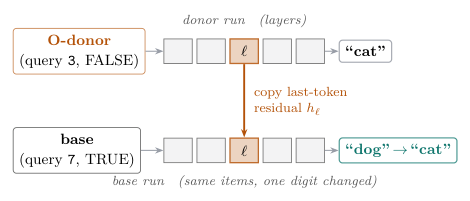

Figure 1: The patching operation. The donor's last-token residual hℓ is copied into the BASE run at layer ℓ. We then record, at every layer, whether the patched answer flips (under the label-mass gate, ≥ 0.30) and the graded fraction-of-swing recovery R.

> [!figure] diagram
> A diagram illustrating the activation patching operation, where the last-token residual from a donor run (query 3, FALSE) is copied into a base run (query 7, TRUE) at layer ℓ, causing the output to flip from "dog" to "cat".
>
> O-donor (query 3, FALSE) -> [layer boxes] -> "cat"
>                  v (copy last-token residual h_ℓ)
>
>                  base (query 7, TRUE) -> [layer boxes] -> "dog" → "cat" (base run: same items, one digit changed)

We report two metrics (Zhang and Nanda, 2024; Heimersheim and Nanda, 2024). The first is a twoway flip probability over {A, B}, gated by label mass: a patch counts as a flip only if the combined probability mass on {A, B} is at least 0.30, so destructive patches that collapse the distribution do not register as flips. The second is a graded fraction-of-swing recovery

$$R \, = \, \frac { L D _ { p a t c h e d } - L D _ { b a s e } } { L D _ { d o n o r } - L D _ { b a s e } } ,$$

where LD = logit(A) - logit(B): how far a patch moves the base logit difference toward the donor's (R=0 no movement, R=1 full recovery). When this fraction-of-swing is computed for a patched head group or subspace rather than a full-layer residual patch, we write it as Φ. Both flip directions are always run (predicate TRUE→flip and FALSE→flip); Figure 1 illustrates the operation.

## 3.3 The Four Donors

For each BASE item (predicate TRUE, answer A = dog) we construct four prompts by crossing the rule mapping (standard vs. swapped) with the query outcome (TRUE vs. FALSE), as laid out in Figure 2:

- BASE: standard rule, query TRUE ⇒ predicate TRUE, answer dog (reference run).
- O-DONOR: standard rule, query FALSE ⇒ predicate FALSE, answer cat. Flips the predicate outcome; only one query digit changes.
- MAP-DONOR: swapped rule (". . . output cat, otherwise dog"), query TRUE ⇒ predicate stays TRUE but the answer becomes cat. Flips the mapping.
- MAP-NULL: swapped rule, query FALSE ⇒ predicate FALSE, answer dog. A large per-

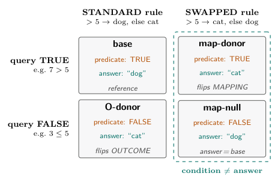

Figure 2: The four donors, crossing rule mapping (standard vs. swapped) with query outcome (TRUE vs. FALSE). In MAP-DONOR and MAP-NULL the predicate truth and the answer word disagree, exposing per layer whether a patched site follows the condition (TEST) or the answer (ROUTE).

> [!figure] table
> A table showing four scenarios (base, O-donor, map-donor, map-null) under two rule conditions (STANDARD and SWAPPED), with query outcomes (TRUE or FALSE) and whether the predicate and answer agree or disagree.
>
> ||STANDARD rule > 5 → dog, else cat|SWAPPED rule > 5 → cat, else dog|
> |---|---|---|
> |query TRUE e.g. 7 > 5|base
> predicate: TRUE
> answer: "dog"
> reference|map-donor
> predicate: TRUE
> answer: "cat"
> flips MAPPING|
> |query FALSE e.g. 3 ≤ 5|O-donor
> predicate: FALSE
> answer: "cat"
> flips OUTCOME|map-null
> predicate: FALSE
> answer: "dog"
> answer = base|
> | | |condition ≠ answer|

> [!warning]- Numbers not found in page text
> 5, 7 — read from the image; check against the figure.

turbation whose answer nonetheless equals BASE.

The methodological core is that MAP-DONOR and MAP-NULL make the condition and the answer disagree (truth value and answer word point to opposite labels), letting us read, per layer, a patch's allegiance: whether the patched output follows the truth value (the TEST stage) or the answer word (the ROUTE stage). The construction is binary here for clarity, but generalizes: a cyclic rotation of the label mapping extends it to a three-output rule (§4.5).

## 3.4 Controls

A behavioral gate admits a cell only if base accuracy is at least 0.85, so that the model actually solves the rule before we interpret its internals. Donor-correctness gating discards any item whose donor prompts are not themselves answered correctly. A perturbation-matched 2 × 2 isolation test contrasts O-DONOR (outcome-flipping, one digit changed) against MAP-DONOR (mapping-flipping, predicate held), certifying that a TEST-band patch reroutes the answer by moving the condition rather than by any incidental surface perturbation.

To rule out a subspace illusion, an illusion-guard compares recovery along the learned truth direction against a random direction of equal norm (values in §4.1). For the argument ROUTE we add a crosslabel-pair transfer control, applying a subspace learned on dog/cat to a held-out label pair; failure to transfer marks the router as entangled with readout rather than separable. We further verify a valid coherent null (NULL\_CROSS: the residual of an unrelated base item) and confirm that an ungated vector null (NULL\_VEC: a norm-matched random vector) collapses once the label-mass gate is applied, so apparent flips are not artifacts of distributional collapse. Significance is assessed with McNemar's test on paired flip outcomes, each cell reporting a single run over its full gated item set.

Verdict criteria. All thresholds were fixed before the grid was run: behavioral gate at accuracy ≥ 0.85; analysis restricted to items whose four donor prompts are all answered correctly; TEST layer taken as the argmax of the O-DONOR flip curve; and strict single-layer isolation requiring, at that layer, MAP-NULL flip ≥ 0.6 with MAP-DONOR flip ≤ 0.2. Per-cell values appear in Table 1, full curves in Appendix F.

## 4 Experiments and Results

Appendix Figure 12 summarizes the design: predicate-TEST localization (§4.1) in every cell of a 6-language × 3-model grid over the shared bank; the router analysis (§4.2) on all three models; generality across families and languages (§4.3); and predicate generality (§4.4) on the primary model. A recruit-vs-build contrast with the weight-stored IOI circuit is deferred to Appendix C. A language enters an analysis only if the model's base accuracy on the shared bank is at least 0.85 (the behavioral gate); every cell reported below clears it ([0.926, 1.000]).

## 4.1 Localizing the Predicate Test

For each item we run per-layer residual patching of the four donors (BASE, O-DONOR, MAP-DONOR, MAP-NULL) at the last-token position. Because MAP-DONOR and MAP-NULL make condition and answer disagree, the patched prediction reveals, per layer, whether that layer carries the condition (TEST) or the routed answer (ROUTE). The primary metric is the 2-way flip probability under the label-mass gate, complemented by the graded recovery R (§3.2). Every curve pools two single-token answer pairs (dog/cat, fox/owl) and both flip directions.

A separable, isolated TEST module. Table 1 reports the complete 18-cell grid; every cell but one returns PASS\_TEST\_ISOLATED (the exception, Qwen3-8B Tamil, is a layer-selection artifact;

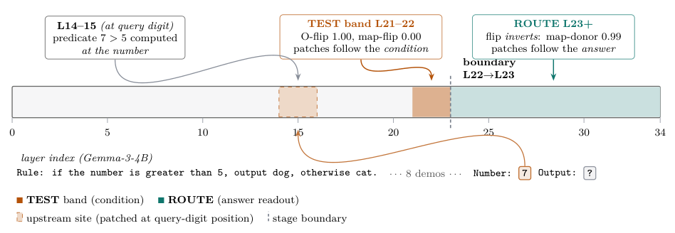

Figure 3: The TEST→ROUTE stage boundary in Gemma-3-4B (English). All patches are applied at the last token of the prompt (the Output: position), which is also the readout site. The predicate is first computed at the query-digit position (L14-15), read out as a truth value at the mid-stack TEST band (L21-22, amber), where the O-DONOR reroutes the answer (1.00) but the MAP-DONOR does not (0.00); patches there follow the condition (MAP-DONOR 0.00, MAP-NULL ≈ 1.0). At L23 the pattern inverts (teal): patches follow the answer word, marking the answer-readout ROUTE stage. Gemma-3-4B is the fused case: readout begins immediately past the band; see Figure 11 for the staggered geometries of Gemma-3-12B (readout onset L29-L35, language-dependent) and Qwen3-8B (L30).

> [!figure] diagram
> A diagram showing the layer-wise progression of a neural network's computation for a rule-based task, highlighting the TEST and ROUTE stages with their respective boundaries and patching behaviors.
>
> layer index (Gemma-3-4B)
> 0  5  10  15  20  25  30  34
>
> [0-5]  [5-10]  [10-15]  [15-20]  [20-25]  [25-30]  [30-34]
>
> Legend:
> ■ TEST band (condition)
> ■ ROUTE (answer readout)
> ↑ upstream site (patched at query-digit position)
> → stage boundary
>
> Annotations:
> L14–15 (at query digit)
>   predicate 7 > 5 computed at the number
>
> TEST band L21–22
>   O-flip 1.00, map-flip 0.00
>   patches follow the condition
>
> boundary
> L22→L23
>
> ROUTE L23+
>   flip inverts: map-donor 0.99
>   patches follow the answer
>
> Rule: if the number is greater than 5, output dog, otherwise cat. … 8 demos … Number: 7 Output: ?

> [!warning]- Numbers not found in page text
> 0, 25, 34, 5, 7 — read from the image; check against the figure.

§4.3): at a single mid-stack residual band, the O-DONOR, which flips only the predicate's truth value, reroutes the answer with probability ≈ 1.0, while the MAP-DONOR, which flips the rule's mapping but leaves the predicate TRUE, leaves the answer essentially unchanged (≈ 0.0). The McNemar tests reject the null throughout (p between 1.4 × 10-47 and 5.7 × 10-57 ).

Stage boundary and controls. Figure 3 shows the stage structure on the primary cell (English, Gemma-3-4B). Three controls confirm a directed truth-value edit, not an artifact. (i) Subspace illusion-guard: patching along the learned truth direction recovers the swing at 0.67, versus 0.03 for a random direction of equal norm. (ii) Upstream localization: patching the query-digit token position flips the answer most strongly at L14-15 (0.83/0.75), decaying to zero by L20: the predicate is first computed at the number and only later moved to the last token. (iii) Stage boundary at L22→L23: within the band (L20-22) patches follow the condition (MAP-DONOR 0.00, MAP-NULL 0.97-1.00); from L23 the pattern inverts (MAP-DONOR 0.99, MAP-NULL 0.00), marking the transition into answer readout. The coherent null (NULL\_CROSS) stays at ≈ 0.04, and NULL\_VEC at ≈ 0.02 once the label-mass gate is applied.

## 4.2 Is the Router Separable?

Does the ROUTE step (mapping the truth value to the answer word) have its own separable, transferable subspace? The readout onset (the first layer where the MAP-DONOR flip reaches 0.9) differs by model (Appendix Figure 11), so each probe is placed at that model's own onset (Table 2). Method 1 greedily accumulates attention heads over each model's readout band (4B L23-30; 12B L32-43; Qwen L30-35). Method 2, "DAS-lite", is a low-rank variant of distributed alignment search (Geiger et al., 2024; Wu et al., 2023): a rank-k orthogonal basis at one residual site, trained on the interchange objective and scored by interchange intervention accuracy (IIA) on held-out items (k ∈ {1, 2, 4, 8}, 48/32 train/test). Both methods run on all three models (English); Appendix Figure 14 illustrates them on the primary cell, Figure 4 the transfer pattern, Table 2 all three models. These probes span greedy head accumulation (Conmy et al., 2023) over each full readout band and rank-1-8 subspaces at the onset site, tested cross-pair in every model, cross-lingually in Gemma-3-4B, and under joint two-pair training; a subspace anywhere in this space that transferred across label pairs would overturn the claim, and none does. The decisive joint case (Gemma-3-4B): a subspace trained on dog/cat and block/allow together fits both at IIA = 1.00 down to rank 1 yet transfers at ≤ 0.01 to held-out fox/owl; its only partial transfer (≤ 0.46, rank-unstable) is to flag/approve, lexically parallel to a trained pair: token geometry, not routing (Appendix A).

Table 1: Predicate-TEST localization across the 18cell grid. Columns: base accuracy (all clear the 0.85 gate); TEST, the O-DONOR-selected layer over model depth (e.g. 22/34: layer 22 of 34); peak, the condition peak (MAP-NULL argmax); O/map, the O-DONOR/MAP-DONOR flip probabilities; McNemar p. Gated n per cell ranges 214-256. Models: Gemma-3-4B, Gemma-3-12B, Qwen3-8B. Every cell but one († ) returns PASS\_TEST\_ISOLATED. †At the O-DONORselected layer the MAP-NULL flip is 0.57, just under the 0.6 isolation cutoff: an artifact of the layer rule, not a Tamil effect; at the condition peak it passes, as every Qwen cell does (§4.3).

| Lang Script   | Model   |   Acc | TEST   |   peak | O/map     |       p |
|---------------|---------|-------|--------|--------|-----------|---------|
| en Latin      | 4B      | 0.961 | 22/34  |     22 | 1.00/0.00 | 3.6e-52 |
| en Latin      | 12B     | 0.996 | 27/48  |     27 | 0.99/0.00 | 1.9e-55 |
| en Latin      | Qwen    | 1.000 | 27/36  |     23 | 0.99/0.00 | 1.6e-56 |
| zh Han        | 4B      | 0.949 | 21/34  |     21 | 0.99/0.01 | 2.5e-49 |
| zh Han        | 12B     | 0.981 | 27/48  |     27 | 0.99/0.00 | 2.4e-54 |
| zh Han        | Qwen    | 1.000 | 23/36  |     23 | 1.00/0.00 | 5.7e-57 |
| hi Deva       | 4B      | 0.953 | 21/34  |     22 | 1.00/0.00 | 6.7e-49 |
| hi Deva       | 12B     | 1.000 | 27/48  |     27 | 0.97/0.00 | 1.9e-55 |
| hi Deva       | Qwen    | 0.965 | 25/36  |     23 | 1.00/0.00 | 2.2e-52 |
| id Latin      | 4B      | 0.938 | 21/34  |     21 | 0.99/0.01 | 1.8e-48 |
| id Latin      | 12B     | 1.000 | 28/48  |     27 | 0.96/0.00 | 8.7e-55 |
| id Latin      | Qwen    | 0.992 | 25/36  |     23 | 1.00/0.00 | 2.6e-56 |
| ta Tamil      | 4B      | 0.938 | 22/34  |     22 | 0.99/0.02 | 8.3e-48 |
| ta Tamil      | 12B     | 0.984 | 27/48  |     27 | 0.96/0.01 | 5.9e-52 |
| ta Tamil      | Qwen†   | 1.000 | 25/36  |     23 | 1.00/0.00 | 5.7e-57 |
| si Sinh.      | 4B      | 0.926 | 22/34  |     22 | 1.00/0.00 | 1.4e-47 |
| si Sinh.      | 12B     | 0.984 | 28/48  |     27 | 0.96/0.01 | 4.8e-53 |
| si Sinh.      | Qwen    | 0.996 | 23/36  |     23 | 0.99/0.00 | 5.3e-55 |

Greedy head-group patching. Where this probe recovers the routing effect at all, the MAP-DONOR (mapping) and O-DONOR (outcome) donors recruit the same heads in nearly the same greedy order: identical for the first five of six heads in Gemma-3-4B (L23H3, L23H1, L30H6, L29H4, L29H5; 0.8× of the full-band swing with 3 heads, full-band Φ = 0.96), and identical for all six in Qwen3-8B (L33H9, L35H26, L31H6, L30H5, . . . ; full-band Φ = 0.58). Gemma-3-12B differs informatively: patching all band heads at once is nearly null (full-band Φ = 0.09), yet the greedy-selected ten-head group recovers Φ = 0.58 with flips 0.91, led by the same head (L41H11) for both donors, nine of ten heads shared. In no model do distinct routing heads emerge: mapping and outcome share the same machinery, their accumulation curves nearly coincident (Appendix Figure 10).

A learned subspace with a transfer control. At each model's readout layer, a learned low-rank subspace (DAS-lite) flips dog ↔ cat with interchange accuracy IIA = 1.00 on held-out items at every rank k ∈ {1, 2, 4, 8} (Table 2); yet under the decisive cross-label-pair transfer control, the same subspace applied to a fresh label pair (fox/owl) flips at ≤ 0.013 in every model (0.00 for Gemma-3-12B and Qwen3-8B, n ≥ 462). The subspace's alignment with the answer-readout direction (the normalized mean MAP-DONOR-BASE residual difference; largest | cos | over learned columns), however, differs by family: in the Gemma models it is moderate (cosine 0.15-0.39), so the flip direction is largely the readout direction itself; in Qwen3-8B it is near zero (cosine 0.01-0.09), a pair-specific direction that neither transfers nor coincides with readout. Optimization-found subspaces can pass interchange tests while illusory (Makelov et al., 2024; Sutter et al., 2025); the transfer control is the direct antidote.

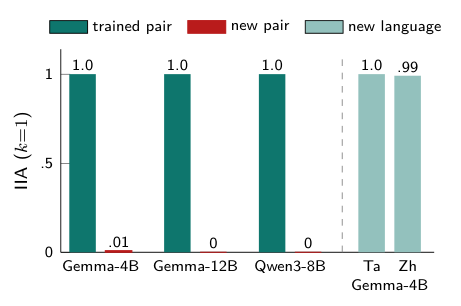

Figure 4: The router transfer pattern (k=1). In every model the learned subspace flips the trained pair perfectly (teal) but transfers to a new pair at ≈0 (red); for Gemma-3-4B the same subspace transfers near-perfectly to the same pair in Tamil and Chinese (light teal): token-bound, language-invariant.

> [!figure] chart
> A bar chart showing the IIA (k=1) scores for different models and language pairs. For Gemma-4B, Gemma-12B, and Qwen3-8B, the trained pair score is 1.0 and the new pair score is near 0. For Gemma-4B in Tamil (Ta) and Chinese (Zh), the new language score is 1.0 and 0.99 respectively.
>
> | Model/Lang | Trained Pair | New Pair | New Language |
>  |------------|--------------|----------|--------------|
>  | Gemma-4B   | 1.0          | .01      |              |
>  | Gemma-12B  | 1.0          | 0        |              |
>  | Qwen3-8B   | 1.0          | 0        |              |
>  | Ta         |              |          | 1.0          |
>  | Zh         |              |          | 0.99         |

> [!warning]- Numbers not found in page text
> 01, 1.0 — read from the image; check against the figure.

Cross-lingual transfer: pair-specific, not language-specific. A second transfer probe pins down what the direction is: we apply the Englishlearned dog/cat subspace (Gemma-3-4B, L23), unchanged, to the same pair in another language (only the rule text differs; the labels are shared Latin tokens). Whereas transfer to a new label pair fails (≤ 0.011), transfer to Tamil and Chinese succeeds almost perfectly at every rank (Tamil 0.97-1.00, Chinese 0.99; the greedy probe re-run in this setting recruits the same heads). The router direction is thus token-specific but language-invariant: the answer-readout direction for those particular tokens, shared across languages because the tokens

Table 2: Router analysis across three models spanning two families (English). DAS flips the answer perfectly at every rank (IIAtest = 1.00) but transfers to a new label pair at ≈ 0 in every model: no separable, transferable router. Cosine with the readout direction is moderate in Gemma (the flip is largely readout) but near-zero in Qwen (a pair-specific direction). The greedy head-patch recovers the swing in 4B/Qwen but not 12B (full-band Φ), so the 12B row rests on the subspace method alone. IIA is on 32 held-out items; transfer is over n ≥ 462 gated items. A larger-sample rerun of the primary cell (150 train, 100 test) gives IIAtest = 0.98-0.99 across ranks with transfer ≤ 0.011, so the interchange result is not a small-sample effect.

| Model     | DAS layer   |   IIAtest k=1:8 | transfer fox/owl   | cos(readout) k=1:8   |   greedy Φfull |
|-----------|-------------|-----------------|--------------------|----------------------|----------------|
| Gemma-4B  | L23         |            1.00 | ≤0.013             | 0.27-0.39            |           0.96 |
| Gemma-12B | L32         |            1.00 | 0.00               | 0.15-0.37            |           0.09 |
| Qwen-8B   | L30         |            1.00 | 0.00               | 0.01-0.09            |           0.58 |

are; that token-binding, not any language binding, makes it non-transferable.

## 4.3 Generality Across Model Families and Languages

Table 1 is itself the cross-cell evidence against three worries. Model idiosyncrasy: the decomposition replicates across Gemma-3-4B, Gemma-3-12B (Team et al., 2025), and Qwen3-8B (Yang et al., 2025) (the cross-family comparison is the real test), with the TEST band at comparable relative depth in each (Gemma-3-4B L21-22, ∼ 0.63; Gemma-3-12B L27-28, ∼ 0.57; Qwen3-8B L23-27). Lexical specificity: beyond the two pooled pairs of §4.1, English reruns with policy-action pairs (block/allow, flag/approve) and with multi-token answers (sub-word splits and two-word phrases; sequence-margin metrics) reproduce the band, isolation, and boundary (Appendix B); the band tracks the predicate's truth value, not a particular answer word or token count. Language specificity: across six languages spanning four scripts, the TEST band sits at the same mid-stack depth with the same isolation signature (O-flip ≈ 1.0, map-flip ≈ 0.0). Both sides are language-agnostic in different senses: the predicate test localizes at a shared depth, and the readout direction is language-invariant (the cross-lingual probe above transfers at ≈ 0.98); only the readout onset can shift by language (12B, Figure 11), consistent with reports of shared mid-stack multilingual computation (Wendler et al., 2024; Zhao et al., 2024; Tezuka and Inoue, 2025).

A cross-family difference in band structure. The per-layer curves expose three per-cell quantities (Appendix Figure 11): the condition peak (MAP-NULL argmax), the selected TEST layer (O-DONOR site), and the readout onset (§4.2). Gemma-3-4B is fused: all three sit within two layers in every language (onset L23 in all six). Qwen3-8B has two language-invariant anchors: condition peak L23 and readout onset L30 in all six languages, the selected TEST layer varying between them. This exposes a limit of our pre-registered layer rule: the O-DONOR flips condition and answer, so its curve saturates across the corridor between condition peak and readout onset (Qwen ≥0.95 from L23 on) and the argmax is settled by single-item differences (Table 1, TEST vs. peak). Where the argmax lands past L23, MAP-NULL has attenuated and Tamil dips below the 0.6 cutoff; at the condition peak all six meet the criterion. The pre-registered verdicts in Table 1 stand. Gemma-3-12B anchors the condition at L27 everywhere but its readout onset is language-dependent (zh L29; en, hi, ta L32; id, si L35). The same attenuation marks every corridor of two or more layers (corridor-mean MAP-NULL flips of 0.00-0.55) while the matched-rule O-DONOR still flips, a graded condition→readout transition rather than a single boundary. Throughout, the TEST anchor is language-invariant; only where the readout crystallizes varies, not its content (§4.2).

## 4.4 Predicate Generality

Is the mechanism specific to greater-than-5, or a general predicate-test? We hold the language fixed (English) and vary the predicate family, keeping the same format and dog/cat labels so only the predicate changes: numeric thresholds t∈{3, 5, 7}, set-membership x∈{2, 3, 5, 7} (a non-monotonic operator), and vowel-initial (a lexical predicate on letters, not numbers). For each family we localize the TEST with the per-layer outcome-donor patch against a coherent null. Appendix Table 4 shows that every family exhibits a clean mid-stack TEST band with peak outcome-flip 1.00 and near-zero null, including the non-monotonic set-membership and the non-numeric vowel predicate; a Qwen3-8B spot-check on the two hardest families (set-membership, vowel) reproduces this (peak-flip 1.00 at L28 and L30). The mechanism is therefore a predicate-test, not a greater-than-5 circuit (per-layer curves in Appendix Figure 13). Selected

TEST layers vary within the band (L20-L29), but every family reaches flip ≥ 0.97 from L21 on, including the two whose accuracy sits near the behavioral gate.

## 4.5 Beyond Binary Rules

We ran a three-output variant on Gemma-3-4B (English): three numeric buckets map to three single-token labels (dog/cat/cow), and the four donors generalize by a cyclic rotation of the label mapping in place of the binary swap (construction in Appendix D). The result matches the binary case: the model solves the rule (behavioral accuracy 0.91) and the same mid-stack TEST band reappears (L18-22, stage boundary L22→L23), with the same isolation signature: O-DONOR and MAP-NULL flip (1.00/0.98) while MAP-DONOR does not (0.00) (Appendix Figure 9): the predicate-TEST module is not tied to a two-label task.

## 5 Discussion

Our central finding is an asymmetry: a single mid-stack band carries the rule's truth value and can be overwritten in isolation, across three models and six languages, while under our probes the ROUTE has no such handle; its learned direction flips only the trained pair.

The TEST stage behaves like a computation over an abstract truth value: the rule text sets up a predicate, evaluated at the query digit and moved to the last token, its result carried on a direction stable enough to swap between prompts. Because outputs follow the truth value below the boundary and the answer above it, the disagreement design licenses calling the TEST a module rather than a shortcut. Two controls argue the band carries the evaluated truth value rather than a relocated query digit (the digit's causal weight decays to zero by L20; a learned truth direction alone recovers 0.67 of the swing), though a cross-threshold patch, not run here, would settle it. The condition anchor, moreover, is language-invariant in every family (Appendix Figure 11), as expected of a language-agnostic truth value; only the readout's timing varies by family and, in 12B, by language.

The ROUTE, though, shows no separable, transferable handle. In all three models a DAS-lite subspace attains IIA 1.00 yet fails to transfer to a new label pair (≈ 0; Table 2). What that direction is varies by family: in Gemma it aligns moderately with answer readout, the apparent router largely the readout seen through one label pair; in Qwen it is orthogonal to readout, a pair-specific direction; the invariant is non-transferability. The cross-lingual probe pins the binding: failing on a new pair yet transferring across languages, the direction tracks the answer tokens, not the rule's language or a routing role. This matches reports of directions that steer effectively without being a faithful, transferable code (Nadaf, 2026; Opiełka et al., 2026).

Practically, the asymmetry predicts that predicate-level steering should be more portable across prompts and label sets than answer-level steering. In the settings where such conditionals ship (Appendix B), single-direction steering (Lee et al., 2025; Arditi et al., 2024) may therefore generalize unevenly, surviving a change of language but not vocabulary; the transfer test cheaply tells the two apart. A separable TEST also offers a monitoring hook: the judged condition is readable mid-stack before the action is emitted, a causal target for truth-probing and judgment/action-mismatch detection (Burns et al., 2023; Marks and Tegmark, 2024).

Holding the answer tokens fixed in Latin script is a deliberate control: native-script labels would make the readout select and render the answer, confounding routing with translation.

## 6 Conclusion

In-context conditional execution factors asymmetrically. The predicate TEST is a separable mid-stack module carrying the rule's truth value: localized by disagreement donors, isolated under matched controls, stable across three models and six languages (on Gemma-3-4B also five predicates, a three-output rule, and multi-token answers). No probe, single-pair or joint, found a transferable ROUTE subspace: the direction is answer-tokenbound, failing new label pairs while transferring across languages in Gemma-3-4B.

## Limitations

Our results come with clear boundaries. All experiments use three open-weight models (Gemma-3-4B/12B, Qwen3-8B); we cannot patch proprietary systems, so we cannot say whether the TEST/ROUTE asymmetry persists at frontier scale. The task is a deliberately controlled synthetic conditional with dog/cat labels held in Latin script across languages: this is what makes the flip metrics interpretable and the readout direction shareable across

languages. A multi-token rerun on the primary cell reproduces the localization under sequence-margin metrics, but native-script conditionals and free-form completions remain open. Activation patching localizes causally load-bearing sites; our claims concern localization and separability, not a complete circuit-level mechanism. On the router side, the full-band head patch is nearly null in Gemma-312B (Φ = 0.09; a greedy ten-head subset recovers 0.58), so the 12B transfer negative rests on the subspace method; the full two-method analysis is English-only, and the cross-lingual transfer probe was run on Gemma-3-4B only (per-language subspace training was not repeated); “entangled with readout” is precise for Gemma while Qwen’s direction is pair-specific without aligning to readout. Joint two-pair training (§4.2) closes the single-pair loophole on the primary model, but wider multi-pair banks, other sites, and nonlinear alignments remain unprobed. Lexical generality rests on two label pairs in the grid (plus two policy-action pairs and two multi-token pairs on the primary cell), the three-output variant was run on Gemma-3-4B in English only, and each cell reports a single seed. The IOI contrast (Appendix C) is suggestive rather than decisive, since the IOI movers are themselves weak and distributed in Gemma-3-4B. Finally, the six languages sample script and resource level, not typological space.

## Ethics Statement

This work is a mechanistic-interpretability study of open-weight language models (Gemma-3-4B, Gemma-3-12B, and Qwen3-8B) on a synthetic task. It involves no human subjects, no user data, and no private or personally identifiable information: every stimulus is generated deterministically from a fixed numeric item bank and a rule template. The multilingual stimuli are machine-rendered from the same template into six languages, with the rule and demonstration scaffold translated and the single-token answer labels held in Latin; the translated rule text was checked by native speakers for each language to ensure the intended predicate is faithfully expressed. All models are publicly released, and our interventions (activation patching on the residual stream) modify only internal activations at inference time, leaving model weights unchanged. We note a dual-use consideration. Localizing a causally separable predicate-TEST module identifies a residual-stream direction at which flipping the truth value reroutes the answer, and such localization could in principle inform activation-steering attempts to manipulate a model’s conditional behavior. We regard the risk as limited: our methods require white-box access to internal activations, the studied task is a controlled synthetic conditional rather than a safety-relevant behavior, and the same interpretability tools are what make such manipulations auditable and detectable. We report these findings to advance scientific understanding of how in-context rules are assembled into runtime circuits, and we encourage that steering insights derived from interpretability be applied toward transparency and control rather than covert behavioral manipulation.

## References

- Andy Arditi, Oscar Obeso, Aaquib Syed, Daniel Paleka, Nina Panickssery, Wes Gurnee, and Neel Nanda. 2024. Refusal in language models is mediated by a single direction. Advances in Neural Information Processing Systems, 37:136037–136083.
- Collin Burns, Haotian Ye, Dan Klein, and Jacob Steinhardt. 2023. Discovering latent knowledge in language models without supervision. In The Eleventh International Conference on Learning Representations.
- Danchun Chen, Qiyao Yan, and Liangming Pan. 2026. Towards a mechanistic understanding of propositional logical reasoning in large language models. arXiv preprint arXiv:2601.04260.
- Arthur Conmy, Augustine Mavor-Parker, Aengus Lynch, Stefan Heimersheim, and Adrià Garriga-Alonso. 2023. Towards automated circuit discovery for mechanistic interpretability. Advances in Neural Information Processing Systems, 36:16318–16352.
- Xander Davies, Max Nadeau, Nikhil Prakash, Tamar Rott Shaham, and David Bau. 2023. Discovering variable binding circuitry with desiderata. arXiv preprint arXiv:2307.03637.
- Clément Dumas, Chris Wendler, Veniamin Veselovsky, Giovanni Monea, and Robert West. 2025. Separating tongue from thought: Activation patching reveals language-agnostic concept representations in Transformers. In Proceedings of the 63rd Annual Meeting of the Association for Computational Linguistics (Volume 1: Long Papers), pages 31822–31841.
- Jiahai Feng and Jacob Steinhardt. 2024. How do language models bind entities in context? In International Conference on Learning Representations, volume 2024, pages 36391–36413.
- Javier Ferrando and Marta R. Costa-jussà. 2024. On the similarity of circuits across languages: a case study on the subject-verb agreement task. In Findings of the Association for Computational Linguistics: EMNLP 2024, pages 10115-10125.
- Atticus Geiger, Zhengxuan Wu, Christopher Potts, Thomas Icard, and Noah Goodman. 2024. Finding alignments between interpretable causal variables and distributed neural representations. In Causal Learning and Reasoning, pages 160-187. PMLR.
- Nicholas Goldowsky-Dill, Chris MacLeod, Lucas Sato, and Aryaman Arora. 2023. Localizing model behavior with path patching. arXiv preprint arXiv:2304.05969.
- Yoav Gur-Arieh, Mor Geva, and Atticus Geiger. 2026. Mixing mechanisms: How language models retrieve bound entities in-context. In The Fourteenth International Conference on Learning Representations.
- Stefan Heimersheim and Neel Nanda. 2024. How to use and interpret activation patching. arXiv preprint arXiv:2404.15255.
- Roee Hendel, Mor Geva, and Amir Globerson. 2023. In-context learning creates task vectors. In Findings of the Association for Computational Linguistics: EMNLP 2023, pages 9318-9333.
- Guan Zhe Hong, Nishanth Dikkala, Enming Luo, Cyrus Rashtchian, Xin Wang, and Rina Panigrahy. 2025. A implies B: Circuit analysis in LLMs for propositional logical reasoning. In Advances in Neural Information Processing Systems (NeurIPS).
- Geonhee Kim, Marco Valentino, and Andre Freitas. 2025. Reasoning circuits in language models: A mechanistic interpretation of syllogistic inference. In Findings of the Association for Computational Linguistics: ACL 2025, pages 10074-10095.
- Bruce W Lee, Inkit Padhi, Karthikeyan Natesan Ramamurthy, Erik Miehling, Pierre Dognin, Manish Nagireddy, and Amit Dhurandhar. 2025. Programming refusal with conditional activation steering. In International conference on learning representations, volume 2025, pages 90960-90985.
- Samuel Lippl, Thomas McGee, Kimberly Lopez, Ziwen Pan, Pierce Zhang, Salma Ziadi, Oliver Eberle, and Ida Momennejad. 2026. Algorithmic primitives and compositional geometry of reasoning in language models. In Proceedings of the 43rd International Conference on Machine Learning.
- Aleksandar Makelov, Georg Lange, Atticus Geiger, and Neel Nanda. 2024. Is this the subspace you are looking for? An interpretability illusion for subspace activation patching. In The Twelfth International Conference on Learning Representations.
- Samuel Marks and Max Tegmark. 2024. The geometry of truth: Emergent linear structure in large language model representations of true/false datasets. In First Conference on Language Modeling.
- Kevin Meng, David Bau, Alex Andonian, and Yonatan Belinkov. 2022. Locating and editing factual associations in GPT. Advances in neural information processing systems, 35:17359-17372.
- Jack Merullo, Carsten Eickhoff, and Ellie Pavlick. 2024. Circuit component reuse across tasks in transformer language models. In International Conference on Learning Representations, volume 2024, pages 18349-18377.
- Mohammed Suhail B Nadaf. 2026. Steerable but not decodable: Function vectors operate beyond the logit lens. arXiv preprint arXiv:2604.02608.
- Catherine Olsson, Nelson Elhage, Neel Nanda, Nicholas Joseph, Nova DasSarma, Tom Henighan, Ben Mann, Amanda Askell, Yuntao Bai, Anna Chen, et al. 2022. In-context learning and induction heads. arXiv preprint arXiv:2209.11895.
- Gustaw Opiełka, Hannes Rosenbusch, and Claire E Stevenson. 2026. Causality ̸= invariance: Function and concept vectors in LLMs. In The Fourteenth International Conference on Learning Representations.
- Philip Quirke. 2026. Ablation-reversible heads don't transfer: A stress test for mechanistic role claims in Transformers. arXiv preprint arXiv:2606.08292.
- Arnab Sen Sharma, Giordano Rogers, Natalie Shapira, and David Bau. 2026. LLMs process lists with general filter heads. In The Fourteenth International Conference on Learning Representations.
- Denis Sutter, Julian Minder, Thomas Hofmann, and Tiago Pimentel. 2025. The non-linear representation dilemma: Is causal abstraction enough for mechanistic interpretability? In Advances in Neural Information Processing Systems (NeurIPS).
- Wei Tang, Xinyan Jiang, Fakhri Karray, and Lijie Hu. 2026. In-context learning operates as concept subspace learning. arXiv preprint arXiv:2605.18830.
- Gemma Team, Aishwarya Kamath, Johan Ferret, Shreya Pathak, Nino Vieillard, Ramona Merhej, Sarah Perrin, Tatiana Matejovicova, Alexandre Ramé, Morgane Rivière, Louis Rouillard, Thomas Mesnard, Geoffrey Cideron, Jean bastien Grill, Sabela Ramos, Edouard Yvinec, Michelle Casbon, Etienne Pot, Ivo Penchev, and 192 others. 2025. Gemma 3 technical report. Preprint, arXiv:2503.19786.
- Hinata Tezuka and Naoya Inoue. 2025. The transfer neurons hypothesis: An underlying mechanism for language latent space transitions in multilingual LLMs. In Proceedings of the 2025 Conference on Empirical Methods in Natural Language Processing, pages 31742-31792.
- Eric Todd, Millicent Li, Arnab Sen Sharma, Aaron Mueller, Byron Wallace, and David Bau. 2024. Function vectors in large language models. In International conference on learning representations, volume 2024, pages 17282-17333.
- Alexandre Variengien and Eric Winsor. 2025. Look before you leap: Universal emergent mechanism for retrieval in language models. In The Thirteenth International Conference on Learning Representations (ICLR).
- Jesse Vig, Sebastian Gehrmann, Yonatan Belinkov, Sharon Qian, Daniel Nevo, Yaron Singer, and Stuart Shieber. 2020. Investigating gender bias in language models using causal mediation analysis. Advances in neural information processing systems, 33:12388-12401.
- Kevin Ro Wang, Alexandre Variengien, Arthur Conmy, Buck Shlegeris, and Jacob Steinhardt. 2023. Interpretability in the wild: a circuit for indirect object identification in GPT-2 small. In The Eleventh International Conference on Learning Representations.
- Chris Wendler, Veniamin Veselovsky, Giovanni Monea, and Robert West. 2024. Do Llamas work in English? On the latent language of multilingual transformers. In Proceedings of the 62nd Annual Meeting of the Association for Computational Linguistics (Volume 1: Long Papers), pages 15366-15394.
- Yiwei Wu, Atticus Geiger, and Raphaël Millière. 2025. How do transformers learn variable binding in symbolic programs? In Proceedings of the 42nd International Conference on Machine Learning, volume 267 of Proceedings of Machine Learning Research, pages 67284-67299. PMLR.
- Zhengxuan Wu, Atticus Geiger, Thomas Icard, Christopher Potts, and Noah Goodman. 2023. Interpretability at scale: Identifying causal mechanisms in Alpaca. Advances in neural information processing systems, 36:78205-78226.
- An Yang, Anfeng Li, Baosong Yang, Beichen Zhang, Binyuan Hui, Bo Zheng, Bowen Yu, Chang Gao, Chengen Huang, Chenxu Lv, Chujie Zheng, Dayiheng Liu, Fan Zhou, Fei Huang, Feng Hu, Hao Ge, Haoran Wei, Huan Lin, Jialong Tang, and 41 others. 2025. Qwen3 technical report. Preprint, arXiv:2505.09388.
- Qinyuan Ye, Robin Jia, and Xiang Ren. 2025. Function induction and task generalization: An interpretability study with off-by-one addition. arXiv preprint arXiv:2507.09875.
- Fred Zhang and Neel Nanda. 2024. Towards best practices of activation patching in language models: Metrics and methods. In The Twelfth International Conference on Learning Representations.
- Yiran Zhao, Wenxuan Zhang, Guizhen Chen, Kenji Kawaguchi, and Lidong Bing. 2024. How do large language models handle multilingualism? Advances in Neural Information Processing Systems, 37:15296-15319.

## A Reproducibility Details

Prompt template. Each prompt is a rule, eight in-context Number/Output demonstrations, and a query number whose answer token the model completes. The canonical English rule is "Rule: if the number is greater than 5, output dog, otherwise output cat." Answer labels dog/cat are single tokens and stay in Latin script across all six languages (en, zh, hi, id, ta, si); the rule and the entire demonstration scaffold are translated, so tokenization variation falls on the prompt text and never on the measured answer. Figure 5 shows one English prompt per predicate family (each abbreviated to two of eight demonstrations). The multilingual banks were built by translating this template (rule text and scaffold keywords) into each of the other five languages and having the result checked and corrected by a native speaker, keeping the numerals and the answer tokens unchanged.

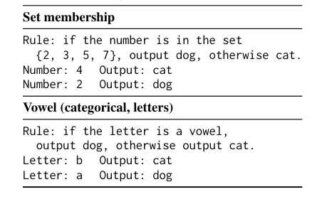

Figure 5: English prompts for each predicate family (abbreviated to two of eight demonstrations). Only the predicate changes; the task format and the single-token dog/cat labels are held fixed. Non-English banks translate the rule and scaffold keywords, with nativespeaker correction, leaving numerals and answer tokens unchanged.

> [!figure] table
> The figure displays two predicate families with their rules and example inputs/outputs. The first is 'Set membership', which outputs 'dog' if the number is in {2, 3, 5, 7}, otherwise 'cat'. The second is 'Vowel (categorical, letters)', which outputs 'dog' for vowels and 'cat' for non-vowels.
>
> ### Set membership
> Rule: if the number is in the set {2, 3, 5, 7}, output dog, otherwise cat.
> Number: 4  Output: cat
> Number: 2  Output: dog
>
> ### Vowel (categorical, letters)
> Rule: if the letter is a vowel, output dog, otherwise output cat.
> Letter: b  Output: cat
> Letter: a  Output: dog

> [!warning]- Numbers not found in page text
> 4, 7 — read from the image; check against the figure.

Fixed item bank. Every experimental cell (each model × each language) draws from one shared bank of 250 items with the numeric greater-than predicate at threshold 5; the shared bank ensures no cell is confounded by different random samples. Predicate families for the generality analysis live in a separate English-only bank; both banks ship with the code release.

Four-donor construction. The four donors cross rule mapping (standard/swapped) with query outcome (TRUE/FALSE) exactly as defined in §3.3; we do not repeat them here.

Models and precision. Gemma-3-4B (34 layers), Gemma-3-12B (48 layers), and Qwen3-8B (36 layers), all run in bfloat16. Layers are 0-indexed over decoder blocks; a patch at layer ℓ copies the donor's residual-stream vector at the block-ℓ output, at the last token position, into the base run.

Metrics. After patching one layer we score the completion. The flip probability is a 2-way mass over {A, B} with a label-mass gate: a patch counts only when the combined label mass is ≥ 0.30, so destructive or incoherent patches do not register as flips. The graded fraction-of-swing recovery is

$$R = \frac { L D _ { p a t c h e d } - L D _ { b a s e } } { L D _ { d o n o r } - L D _ { b a s e } } ,$$

with LD = logit(A) - logit(B). Both flip directions (TRUE→flip and FALSE→flip) are run.

DAS-lite training. The subspace is a semiorthogonal basis Q ∈ Rd×k (orthogonal parametrization), trained with Adam (learning rate 10-2 , batch 16, 150 epochs) to minimize the crossentropy of the patched logits against the counterfactual mapping target; IIA is argmax-amonglabels agreement with that target on held-out items, and the null is an untrained random subspace of matched rank. Every experiment reports a single seed per cell.

Joint two-pair DAS. Single-pair training cannot in principle discover a router shared across pairs, so on the primary cell (English, Gemma-3-4B) we retrained the subspace jointly on dog/cat and block/allow (interleaved batches, 24 train/16 test per pair, same site, objective, and gates). At every rank k ∈ {1, 2, 4, 8} the joint subspace reaches IIAtest = 1.00 on both trained pairs (rank 1 suffices for both jointly), yet transfers at ≤ 0.009 to the unrelated held-out pair fox/owl (n=114; randomsubspace null 0.00). Transfer to flag/approve (n=112) is partial and rank-unstable (0.00, 0.46, 0.07, 0.32 for k=1, 2, 4, 8): what transfer exists follows the lexical similarity of the answer tokens (block∼flag, allow∼approve) and vanishes for unrelated vocabulary, the signature of readoutgeometry overlap rather than an abstract routing variable.

Grid layout. In the released code, results are organized per language, model, and experiment (one directory per cell), so the per-cell tables in the main text map directly onto the release; the experiments there carry short internal identifiers (E1 = predicate-TEST localization, E2 = router separability, E3 = predicate generality, E6 = IOI contrast, E7 = the three-output rule, E8 = multi-token answers, E9 = joint two-pair DAS). The cross-model and crosslanguage analyses (internally E4/E5) are computed from the stored E1 outputs and have no separate directories.

Compute and software. All experiments run on single workstation-class NVIDIA GPUs in bfloat16 via PyTorch and HuggingFace transformers; no run requires more than one GPU. A localization cell (one model × one language) takes roughly one to two GPU-hours on Gemma-3-4B and proportionally more for the larger models; the router analysis (greedy sweep + DAS training) takes one to two GPU-hours per model, and the three-output run under one GPUhour. No distributed training is involved; model weights are never updated. Gemma-3 models are used under the Gemma Terms of Use and Qwen3-8B under its Apache-2.0 license.

## B Realistic Conditional Rules

The studied template is the minimal shared skeleton of conditional instructions that ship in real prompts. Each maps onto the same three roles: a predicate over an input, a true-branch action, a false-branch action.

Table 3: Deployed prompt patterns instantiating "if P (x) then A else B." The third pattern is, up to wording, the studied rule, and is run directly below.

| Deployed rule                                                           | Predicate P (x)         | Branches A/B      |
|-------------------------------------------------------------------------|-------------------------|-------------------|
| "If the request asks for medical ad- vice, refuse; other- wise answer." | topic of the re- quest  | refuse / answer   |
| "If the user men- tions a refund, route to billing; else to support."   | intent of the mes- sage | billing / support |
| "If the order total exceeds the limit, flag it; otherwise approve."     | numeric threshold       | flag / approve    |

Our canonical rule isolates this skeleton under controlled conditions: single-token branch labels

(relaxed to multi-token labels below) make the flip metrics exact, and a numeric predicate makes truth assignment unambiguous. What the findings imply for the deployed forms follows the two stages. The TEST band is separable, language-invariant, and generalizes across predicate families, label pairs, a three-output rule, and multi-token answers; this suggests the judgment half of such rules is a stable target for probing and portable steering. The ROUTE result cautions that any intervention built on the action half is token-bound: it will not survive a change of action vocabulary (refuse → decline), though it does survive a change of prompt language.

As a direct check, we reran the localization on the primary cell (English, Gemma-3-4B) with two policy-action pairs (block/allow and flag/approve, both single tokens) in place of the noun pairs, with no other change. The model solves the rule at accuracy 0.984 (n=228 gated items), and the localization reproduces exactly: TEST layer L20 with O-DONOR flip 0.99, MAP-DONOR 0.00, MAP-NULL 0.94 (McNemar p = 3.3 × 10-50 ), nulls ≤ 0.031, the same L22→L23 stage boundary, and the same verdict as the grid cells (PASS\_TEST\_ISOLATED; Figure 6). The skeleton's behavior is unchanged when its branches are the action words of the deployed patterns above.

Gemma-3-4B: policy-action labels (block/allow, flag/approve)

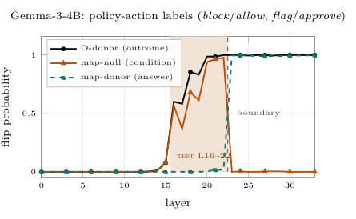

Figure 6: Policy-action labels (Gemma-3-4B, English; block/allow and flag/approve pooled): per-layer flip for the O-DONOR (outcome), MAP-NULL (condition) and MAP-DONOR (answer) donors. The shaded band (layers with O-DONOR flip ≥ 0.6 and MAP-DONOR flip ≤ 0.2) contains the noun-label TEST band, and the L22→L23 stage boundary is identical.

> [!figure] chart
> A line chart showing flip probability across layers for three categories: O-donor (outcome), map-null (condition), and map-donor (answer). The chart highlights a TEST band around layer L16-20 and a stage boundary between layers L22 and L23.
>
> | layer | O-donor (outcome) | map-null (condition) | map-donor (answer) |
>  |---|---|---|---|
>  | 0 | 0 | 0 | 0 |
>  | 5 | 0 | 0 | 0 |
>  | 10 | 0 | 0 | 0 |
>  | 15 | 0.5 | 0 | 0 |
>  | 20 | 1 | 1 | 1 |
>  | 25 | 0 | 0 | 0 |
>  | 30 | 0 | 0 | 0 |

> [!warning]- Numbers not found in page text
> 0, 0.5, 1, 15, 16, 25, 30, 5 — read from the image; check against the figure.

A second check removes the single-token constraint itself. We generalized the metrics to multi-token answers (the flip becomes a teacher-forced sequence-margin sign change, with the patch held at the prompt's last-token position while candidate tokens are scored, and the mass gate applied to the candidates' first tokens) and reran the localization with two multi-token pair types pooled: sub-wordsplit single words (wheelbarrow/grasshopper) and two-word phrases (snow leopard/tree frog), each two tokens with distinct first tokens. The model solves the rule at accuracy 0.964 (n=168 gated), and the localization reproduces once more: TEST layer L20 (condition peak L21), O-DONOR flip 0.99, MAP-DONOR 0.02, MAP-NULL 0.94 (McNemar p = 6.8 × 10-37 ), nulls ≤ 0.04, and the same L22→L23 boundary (Figure 7). Gemma-3's 256k vocabulary makes virtually every common English noun a single token, so multi-token answers require sub-word-split or multi-word candidates by construction.

Gemma-3-4B: multi-token answers

(wheelbarrow/grasshopper, snow leopard/tree frog)

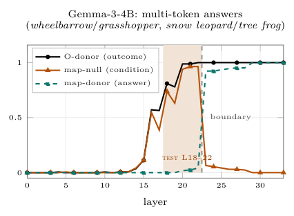

Figure 7: Multi-token answers (Gemma-3-4B, English; sub-word pair and two-word-phrase pair pooled, sequence-margin metrics): per-layer flip for the O-DONOR (outcome), MAP-NULL (condition) and MAP-DONOR (answer) donors. The shaded band (same criterion as Figure 6) contains the single-token TEST band, with the same L22→L23 boundary.

> [!figure] chart
> A line chart showing flip metrics for three categories—O-donor (outcome), map-null (condition), and map-donor (answer)—across model layers. The chart highlights a TEST band around layer L18-L22 and a stage boundary at L22.
>
> | layer | O-donor (outcome) | map-null (condition) | map-donor (answer) |
>  |---|---|---|---|
>  | 0 | 0 | 0 | 0 |
>  | 5 | 0 | 0 | 0 |
>  | 10 | 0 | 0 | 0 |
>  | 15 | 0.5 | 0.5 | 0 |
>  | 20 | 1 | 1 | 1 |
>  | 25 | 0 | 0 | 0 |
>  | 30 | 0 | 0 | 0 |

> [!warning]- Numbers not found in page text
> 0, 0.5, 1, 15, 18, 25, 30, 5 — read from the image; check against the figure.

Untested here, and required before these implications carry to production rules: native-script actions, compositional predicates, and free-form rather than constrained-choice completions (§4.3; Limitations).

## C Recruit vs. Build: The IOI Contrast

Is the conditional circuit recruited from a pretrained mechanism or built at inference? We contrast it (English, Gemma-3-4B) with the canonical weight-stored circuit, Indirect Object Identification (IOI) (Wang et al., 2023): "When John and Mary went to the store, John gave a drink to" → "Mary". With the same interchange machinery, we rank the IOI mover heads (those carrying the IO/S logit difference to the last token under a role-swap cor-

ruption) and measure their overlap with our conditional's heads.

Two caveats frame one clean result (Figure 8). First, the IOI movers are individually weak here (the strongest recovers only Φ = 0.27 of the swing, three of ten with zero OV copy-score), so IOI in Gemma-3-4B is itself distributed and the mover ranking is a weak-signal set; the contrast is suggestive, not decisive. Second, since mover heads live late by construction, zero mid-stack overlap is partly expected; the depth-matched comparison is against the ROUTE band, and there the asymmetry appears: no IOI mover falls in the predicate-TEST band L20-22 (overlap 0.00), while the depth-matched ROUTE heads share 3 of 10 movers (L23H3, L26H3, L29H4; overlap 0.30, Jaccard 0.18), consistent with the ROUTE drawing on general late-layer readout machinery that IOI also uses, rather than a dedicated recruited circuit. Reported per head-set rather than collapsed to one number, the verdict is TEST: distinct (built) / ROUTE: shared: the same TEST/ROUTE asymmetry the router analysis found (§4.2), seen from a different angle.

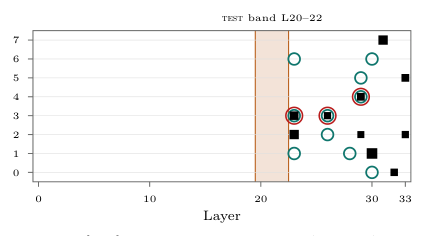

Figure 8: IOI-contrast head map (Gemma-3-4B): IOI mover heads (black, sized by Φ) never fall in the TEST band (amber); three coincide with our ROUTE heads (teal circles; shared heads ringed red).

> [!figure] chart
> A scatter plot showing head activation values across layers, with a vertical band labeled 'TEST band L20-22' highlighted in amber. Black squares represent IOI mover heads, sized by Φ, and none fall within the TEST band. Teal circles represent ROUTE heads, with three overlapping with the IOI mover heads; these shared heads are circled in red.
>
> Layer | 0 | 10 | 20 | 30 | 33
> ---|---|---|---|---|---
> Value | 0 | 0 | 0 | 0 | 0
>
> Layer | 0 | 10 | 20 | 30 | 33
> ---|---|---|---|---|---
> Value | 0 | 0 | 0 | 0 | 0
>
> Layer | 0 | 10 | 20 | 30 | 33
> ---|---|---|---|---|---
> Value | 0 | 0 | 0 | 0 | 0

> [!warning]- Numbers not found in page text
> 30, 33 — read from the image; check against the figure.

## D The Three-Output Rule

The three-output variant (§4.5) uses three numeric buckets with two thresholds (x ≥ 5, 2 ≤ x ≤ 4, x ≤ 1) mapped to three single-token labels A, B, C (dog/cat/cow). In place of the binary swap, the mapping is a cyclic rotation r ∈ {0, 1, 2}: bucket b takes label (b+r) mod 3, so the rule always contains the three label words once each and every prompt tokenizes to the same length. Demonstrations cover all three buckets. For a base query in the top bucket under the standard mapping (answer A), with common flip target B, the four donors are: BASE (r=0, top bucket → A); O-DONOR (r=0, middle bucket → B, a one-boundary move); MAP-DONOR (r=1, top bucket → B, rotated map, same bucket); and MAP-NULL (r=2, middle bucket → A, rotated map whose answer returns to the base). A condition-carrying layer follows the donor's bucket: the base's own rule then maps the middle bucket to B, so O-DONOR and MAP-NULL flip while MAP-DONOR (same bucket) does not; a readout layer follows the answer word, so MAP-DONOR and O-DONOR flip while MAP-NULL does not. This is the binary isolation logic with a rotation standing in for the swap. Figure 9 shows the resulting per-layer curves.

Gemma-3-4B: three-output rule (dog/cat/cow)

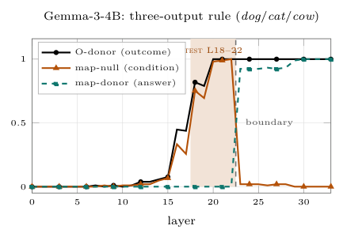

Figure 9: Three-output rule (Gemma-3-4B): per-layer flip for the O-DONOR (outcome), MAP-NULL (condition) and MAP-DONOR (answer) donors of the dog/cat/cow variant. The shaded band (L18-22, same criterion as Figure 6) contains the binary TEST band, and the L22→L23 stage boundary is identical: below it patches follow the condition (O-DONOR, MAP-NULL), above it the answer word (MAP-DONOR).

> [!figure] chart
> A line chart showing three curves for O-donor (outcome), map-null (condition), and map-donor (answer) across layers in Gemma-3-4B, with a shaded region indicating the TEST band (L18–22) and a boundary at L22→L23.
>
> layer | 0 | 5 | 10 | 15 | 20 | 25 | 30
> ---|---|---|---|---|---|---|---
> O-donor (outcome) | 0 | 0 | 0 | 0 | 1 | 1 | 1
> map-null (condition) | 0 | 0 | 0 | 0 | 1 | 0 | 0
> map-donor (answer) | 0 | 0 | 0 | 0 | 0 | 0 | 0

> [!warning]- Numbers not found in page text
> 25, 30 — read from the image; check against the figure.

## E Additional Figures

Figures 10-14 provide the greedy headaccumulation curves, the per-cell band geometry, the predicate-generality curves, the experimentaldesign overview, and the router-methods schematic referenced from the main text.

## F Per-Language Flip Curves

Figures 15-17 plot the per-layer flip probabilities behind Table 1: one panel pair per model, six languages overlaid, with the O-DONOR patch left, the MAP-DONOR patch right, and shading marking the selected TEST layers. They show the per-language

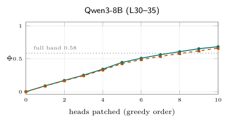

Figure 10: Greedy head-group patching: fraction-ofswing Φ as heads are added in greedy order, for the mapping and outcome donors (English). The two curves are nearly coincident in every model: the same heads, recruited in nearly the same order, carry both the mapping and the outcome, so no distinct routing heads emerge. Dotted line: patching the whole band at once. Gemma-3-4B reaches 0.8× the full-band effect with three heads; in Gemma-3-12B the greedy group far exceeds the full-band patch (0.58 vs. 0.09), i.e. patching all band heads together largely cancels.

> [!figure] chart
> A line chart showing the fraction-of-swing Φ as heads are added in greedy order for Qwen3-8B (L30-35). Two lines, one solid and one dotted, both start near 0 and increase, with the solid line slightly above the dotted line. A horizontal dotted line at Φ=0.58 is labeled 'full band 0.58'.
>
> | heads patched (greedy order) | 0 | 2 | 4 | 6 | 8 | 10 |
>  |---|---|---|---|---|---|---|
>  | Φ | 0 | 0.1 | 0.2 | 0.3 | 0.4 | 0.5 |
>
> Note: The chart has two lines (solid and dotted) that both increase from 0 to near 0.5, with the solid line slightly above the dotted line. A horizontal dotted line at Φ=0.58 is labeled 'full band 0.58'.

> [!warning]- Numbers not found in page text
> 0, 0.1, 0.2, 0.3, 0.4, 0.5, 6 — read from the image; check against the figure.

Table 4: Predicate generality (Gemma-3-4B, English). Every predicate family localizes a clean mid-stack TEST band with peak outcome-flip 1.00 and null ≤ 0.05, including non-monotonic set-membership and the non-numeric vowel predicate. A Qwen3-8B spot-check reproduces set-membership (L28) and vowel (L30) at peak-flip 1.00.

| Predicate | Domain | Behav. acc | TEST layer | peak flip |
| --- | --- | --- | --- | --- |
| $x > 3$ | numbers | 0.875 | L27 | 1.00 |
| $x > 5$ | numbers | 1.000 | L20 | 1.00 |
| $x > 7$ | numbers | 0.979 | L29 | 1.00 |
| $x \in \{2, 3, 5, 7\}$ | numbers | 0.979 | L20 | 1.00 |
| vowel(x) | letters | 0.854 | L22 | 1.00 |

readout onset (map-donor flip ≥ 0.9)

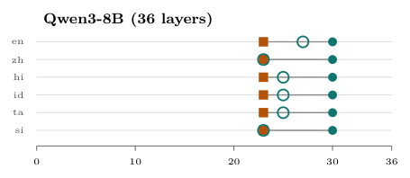

Figure 11: Condition peak (MAP-NULL argmax, amber square), selected TEST layer (O-DONOR site, open teal circle), and readout onset (first MAP-DONOR flip ≥ 0.9, filled teal dot) for every cell, computed from the stored per-layer curves. Gemma-3-4B fuses all three; Qwen3-8B holds both the condition (L23) and the readout onset (L30) language-invariant with the TEST site between them; Gemma-3-12B anchors the condition (L27) but its readout onset varies by language (L29-L35).

> [!figure] chart
> A horizontal bar chart showing for six languages the positions of three markers: an amber square (condition peak), an open teal circle (selected TEST layer), and a filled teal dot (readout onset), all plotted against layer number for the Qwen3-8B model.
>
> Qwen3-8B (36 layers)
> | Language | Condition Peak | TEST Layer | Readout Onset |
> |---|---|---|---|
> | en | 20 | 25 | 30 |
> | zh | 20 | 25 | 30 |
> | hi | 20 | 25 | 30 |
> | id | 20 | 25 | 30 |
> | ta | 20 | 25 | 30 |
> | si | 20 | 25 | 30 |

> [!warning]- Numbers not found in page text
> 25, 36 — read from the image; check against the figure.

coincidence of the TEST band, the stage boundary, and the readout-onset geometry of §4.3.

predicate-test localization: run in every cell

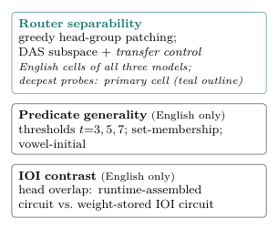

Figure 12: Experimental design. One fixed 250-item bank feeds every cell of the 6-language × 3-model localization grid (only the rule text is translated; the single-token Latin labels are held fixed). The router analysis runs on the English cells of all three models; the teal outline marks the primary cell (English, Gemma-3-4B), which also hosts the cross-lingual transfer probe and the label-generality replications. Predicate generality and the IOI contrast are English-only companion analyses.

> [!figure] diagram
> A diagram showing three labeled boxes representing different experimental analyses: Router separability, Predicate generality, and IOI contrast, with brief descriptions under each.
>
> Router separability
> - greedy head-group patching;
> - DAS subspace + transfer control
> - deepest probes: primary cell (teal outline)
>
> Predicate generality (English only)
> - thresholds t=3, 5, 7; set-membership;
> - vowel-initial
>
> IOI contrast (English only)
> - head overlap: runtime-assembled circuit vs. weight-stored IOI circuit

> [!warning]- Numbers not found in page text
> 5, 7 — read from the image; check against the figure.

Gemma-3-4B (34 layers): O-donor flip, five predicate families

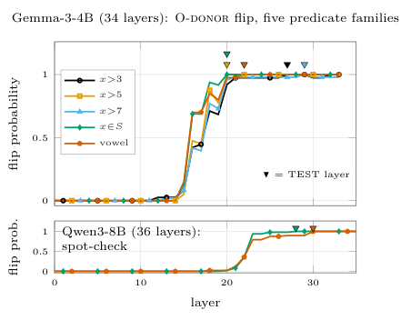

Figure 13: Predicate generality (Gemma-3-4B): per-layer O-DONOR flip for all five predicate families, each reaching 1.0 in the mid-stack band; triangles mark selected TEST layers. Bottom strip: Qwen3-8B spot-check (set-membership, vowel). Max null flip 0.062.

> [!figure] chart
> Two line charts showing O-DONOR flip probability across layers for Gemma-3-4B and Qwen3-8B. The top chart displays five predicate families, each reaching 1.0 in the mid-stack band, with triangles marking TEST layers. The bottom chart is a spot-check for Qwen3-8B.
>
> layer | 0 | 10 | 20 | 30
> ---|---|---|---|---
> Gemma-3-4B (34 layers): O-DONOR flip, five predicate families
> flip probability | 0 | 0 | 0 | 0
>
> layer | 0 | 10 | 20 | 30
> ---|---|---|---|---
> Qwen3-8B (36 layers): spot-check
> flip prob. | 0 | 0 | 0 | 0

> [!warning]- Numbers not found in page text
> 0, 10, 20, 30, 36 — read from the image; check against the figure.

Verdict: entangled with readout; no separable, transferable router.

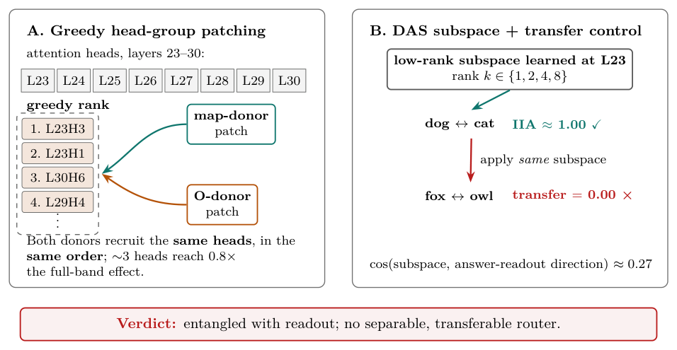

Figure 14: Two probes of the argument ROUTE step, shown on the primary cell (Gemma-3-4B, English; see Table 2 for all three models). Left: greedy head-group patching over L23-30 recruits the same heads in the same order for the mapping (MAP-DONOR) and the outcome (O-DONOR) donors. Right: a DAS-lite subspace at L23 flips dog ↔ cat (IIA = 1.00) but does not transfer to a new label pair (fox/owl, ≈ 0.01; cosine with the answer-readout direction 0.27-0.39). Verdict: ENTANGLED\_WITH\_READOUT.

> [!figure] diagram
> Two diagrams showing probes of the ROUTE step in a model. Left diagram shows greedy head-group patching recruits the same heads in the same order for two donors. Right diagram shows a DAS-lite subspace flips dog ↔ cat with IIA ≈ 1.00 but does not transfer to fox ↔ owl, with transfer = 0.00 and cosine ≈ 0.27.
>
> A. Greedy head-group patching\nattention heads, layers 23-30:\nL23  L24  L25  L26  L27  L28  L29  L30\n\ngreedy rank\n1. L23H3\n2. L23H1\n3. L30H6\n4. L29H4\n\nBoth donors recruit the same heads, in the same order; ~3 heads reach 0.8×\nthe full-band effect.\n\n→ map-donor patch\n→ O-donor patch\n\nB. DAS subspace + transfer control\nlow-rank subspace learned at L23\nrank k ∈ {1,2,4,8}\n\ndog ↔ cat  IIA ≈ 1.00 √\n→ apply same subspace\n→ fox ↔ owl  transfer = 0.00 ×\ncos(subspace, answer-readout direction) ≈ 0.27\n\nVerdict: entangled with readout; no separable, transferable router.

> [!warning]- Numbers not found in page text
> 0.00, 0.8, 1, 12, 24, 25, 26, 27, 28, 29, 48, 6 — read from the image; check against the figure.

## Gemma-3-4B (34 layers)

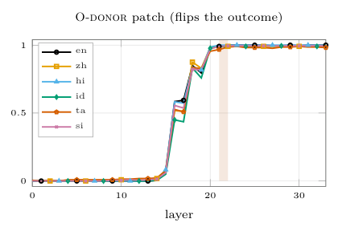

Figure 15: Gemma-3-4B: per-layer flip probability for all six languages. Left: O-DONOR; right: MAP-DONOR. Shading: range of selected TEST layers (L21-22).

> [!figure] chart
> A line chart showing per-layer flip probability for six languages in the O-DONOR patch, with the x-axis representing layer number and y-axis representing flip probability. Each language is represented by a distinct colored line with markers.
>
> layer | en | zh | hi | id | ta | si
> ---|---|---|---|---|---|---
> 0 | 0 | 0 | 0 | 0 | 0 | 0
> 10 | 0 | 0 | 0 | 0 | 0 | 0
> 20 | 1 | 1 | 1 | 1 | 1 | 1
> 30 | 1 | 1 | 1 | 1 | 1 | 1

> [!warning]- Numbers not found in page text
> 0, 1, 10, 20 — read from the image; check against the figure.

## Gemma-3-12B (48 layers)

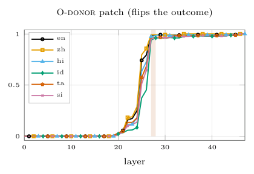

Figure 16: Gemma-3-12B: as above; TEST band L27-28. The MAP-DONOR rise varies by language downstream of the boundary while the O-DONOR curves coincide.

> [!figure] chart
> A line chart showing the values for six different languages (en, zh, hi, id, ta, si) across layers, with all lines converging and remaining at a high value after layer 25.
>
> | layer | en | zh | hi | id | ta | si |
>  |---|---|---|---|---|---|---|
>  | 0 | 0 | 0 | 0 | 0 | 0 | 0 |
>  | 10 | 0 | 0 | 0 | 0 | 0 | 0 |
>  | 20 | 0 | 0 | 0 | 0 | 0 | 0 |
>  | 25 | 0 | 0 | 0 | 0 | 0 | 0 |
>  | 30 | 1 | 1 | 1 | 1 | 1 | 1 |
>  | 40 | 1 | 1 | 1 | 1 | 1 | 1 |

> [!warning]- Numbers not found in page text
> 0, 1, 10, 20, 25, 30, 40 — read from the image; check against the figure.

## Qwen3-8B (36 layers)

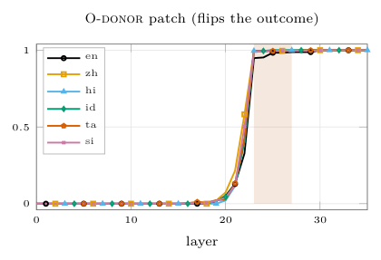

Figure 17: Qwen3-8B: as above; TEST band L23-27. The MAP-DONOR rise is displaced several layers past the band: the staggered condition→readout structure.

> [!figure] chart
> A line chart showing six data series labeled en, zh, hi, id, ta, and si, plotted against layer numbers from 0 to 30. All lines start near 0, rise sharply after layer 20, and plateau near 1. A shaded region covers layers 22 to 30.
>
> layer | 0 | 5 | 10 | 15 | 20 | 25 | 30
> ---|---|---|---|---|---|---|---
> en | 0 | 0 | 0 | 0 | 0.05 | 1 | 1
> zh | 0 | 0 | 0 | 0 | 0.1 | 1 | 1
> hi | 0 | 0 | 0 | 0 | 0.05 | 1 | 1
> id | 0 | 0 | 0 | 0 | 0.05 | 1 | 1
>  ta | 0 | 0 | 0 | 0 | 0.05 | 1 | 1
>  si | 0 | 0 | 0 | 0 | 0.05 | 1 | 1

> [!warning]- Numbers not found in page text
> 0, 0.05, 0.1, 1, 10, 15, 20, 22, 25, 30, 5 — read from the image; check against the figure.

## Validation

| page | route | attempt | status | failed checks |
|---|---|---|---|---|
| 1 | docling | 1 | verified | heading_presence |
| 4 | docling | 1 | verified | figure_grounding |
| 5 | docling | 1 | verified | numeric_agreement, figure_grounding |
| 6 | docling | 1 | verified | figure_grounding |
| 9 | text_layer | 3 | verified | reference_fields |
| 11 | docling | 1 | verified | numeric_agreement, figure_grounding |
| 13 | docling | 1 | verified | numeric_agreement, figure_grounding |
| 14 | docling | 1 | verified | numeric_agreement, figure_grounding |
| 15 | docling | 1 | verified | numeric_agreement, figure_grounding |
| 16 | docling | 1 | verified | numeric_agreement, figure_grounding |
| 17 | docling | 1 | verified | numeric_agreement, figure_grounding |
| 18 | docling | 1 | verified | numeric_agreement, figure_grounding |

## Document checks

Evaluator-optimizer iterations: 2

| check | passed | severity | detail |
|---|---|---|---|
| identity | True | blocker | iter 1: year (year 2023 vs 2026); venue (venue from record) / iter 2: draft matches arxiv |
| ocr_pages | True | blocker | all pages verified |
| code_links | True | info | https://github.com/Luxshan2000/icl-conditional-circuits |
| citations | True | warn | 7/41 checked references unresolved or mismatched (0.17) |

## References check

| status | score | strategy | reference | matched |
|---|---|---|---|---|
| mismatch | 0.59 | exhausted | Gustaw Opiełka, Hannes Rosenbusch, and Claire E Stevenson. 2026. Causality ̸= invariance: Function and concept vectors i | Some Remarks on Causality and Invariance |
| mismatch | 0.51 | exhausted | Philip Quirke. 2026. Ablation-reversible heads don't transfer: A stress test for mechanistic role claims in Transformers | Mechanistic Investigation of the Rhodium-Catalyzed Transfer Hydroarylation React |
| mismatch | 0.69 | exhausted | Arnab Sen Sharma, Giordano Rogers, Natalie Shapira, and David Bau. 2026. LLMs process lists with general filter heads. I | Learning Representations of Hierarchical Slates in Collaborative Filtering |
| unresolved | 0.00 | exhausted | Gemma Team, Aishwarya Kamath, Johan Ferret, Shreya Pathak, Nino Vieillard, Ramona Merhej, Sarah Perrin, Tatiana Matejovi | no strategy produced a verified match |
| mismatch | 0.65 | exhausted | Alexandre Variengien and Eric Winsor. 2025. Look before you leap: Universal emergent mechanism for retrieval in language | Look Before You Leap Into Ph.D. |
| mismatch | 0.78 | exhausted | Jesse Vig, Sebastian Gehrmann, Yonatan Belinkov, Sharon Qian, Daniel Nevo, Yaron Singer, and Stuart Shieber. 2020. Inves | What changed? Investigating Debiasing Methods using Causal Mediation Analysis |
| unresolved | 0.00 | exhausted | Yiwei Wu, Atticus Geiger, and Raphaël Millière. 2025. How do transformers learn variable binding in symbolic programs? I | no strategy produced a verified match |
